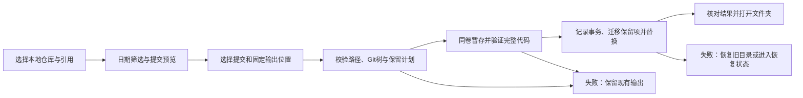

# GitScope 设计草案

版本：v0.4；日期：2026-11-17；基线：PLAN-2026-11-17-C、实施契约v1。状态：本地查询/导出/保留/恢复已实现并通过首个贯通检查点；fetch及第一版完整验收待续。依据：[需求与约束](proposal.md)、[正式证据](evidence/implementation-checkpoint.md)、[调研](research.md)、原日期的[现状调查](current-state.md)与[查询证据](evidence/git-query-validation.md)。DEC/P的权威记录只在proposal；本页定义模块/契约。

## 1. 形态与轻量化

P-05已按用户DEC-14收敛为**.NET10 LTS + WinForms**，SDK10.0.404在项目.tools，正式目标net10.0-windows。本机交付依赖共享Desktop Runtime；随项目启动脚本优先使用便携工具链的10.0.15运行时。选择依据为复用现有UI和准备成本；没有Tauri同条件性能结果，不宣布性能胜负。公共实现契约见[contracts](contracts.md)。

Tauri 在 Windows 使用 WebView2；开发需要 Rust 和 C++ Build Tools。共享 Evergreen Runtime 可由多个应用使用，缺失时仍要安装。采用共享运行时是减小应用分发内容的方向，不能据此推断实际内存或总磁盘占用。参考官方资料 S-01 至 S-03。

.NET WPF/WinForms依赖共享Desktop Runtime的部署也可缩小应用自身分发内容，自包含则携带运行时；具体UI框架、目标框架和受支持版本在TASK-01选择并记录。两种方案均不得凭宣传认定内存更低。约束、来源和未验证项见research中的R-02/R-03。

2026-11-10只读观察：Git2.42.0.windows.1、WebView2安装目录和.NET SDK8.0.421，PATH未见rustc/cargo；这是历史环境证据，TASK-01开始前重新检查，不当作2026-11-17已经验证的开发环境。

交付先覆盖DEC-07的本机版本与架构。程序运行不依赖前端开发服务器；Git及所选共享运行时启动时检测。分发到其他电脑/离线安装器不作为首版必做。无常驻服务、无自动启动；关闭窗口取消可取消任务，临界事务收尾后真正退出。测量包含应用整个进程组。

现成工具TortoiseGit的官方手册描述日志筛选和归档导出等前半流程，未证实能满足本项目固定目录更新/可选保留/事务恢复。它作为交互参照，不擅自替代用户的新项目目标；未安装体验不声称实测（research R-01）。

## 2. 模块与调用方向

| 模块 | 职责与边界 | 关联需求 |
| --- | --- | --- |
| 桌面界面 | 仓库/引用/日期/目标选择、列表与详情、阶段提示；不执行任意 shell 或直接删除目录 | REQ-001、003、004、008 |
| 应用协调层 | 请求 ID、选择状态、查询取消、导出互斥、错误映射；组合其余模块 | REQ-003、007、009 |
| RepositoryService | 识别仓库与完整 ref、冻结 OID、手动 fetch；不替用户 checkout/pull | REQ-001、002 |
| HistoryService | 读取提交元数据、精确日期过滤、排序分页、变更预览 | REQ-003、004 |
| SnapshotExporter | 枚举所选 Git 树、预检特殊条目、读取 blob 并写入暂存；不直接动目标目录 | REQ-005 |
| PreservationPlanner | 规范化保留根、核对旧/新跟踪路径、冻结本地身份；不自动安装/合并依赖 | REQ-006 |
| TargetTransaction | 归属与锁、暂存验证、保留根迁移、目录替换及逆向恢复、受限清理 | REQ-006、007 |
| DependencyNotice | 对比声明/锁文件对象，只提示变化/未知，不认为node_modules已同步 | REQ-004 |
| LocalStateStore | 最近使用配置、输出目录归属、事务日志、脱敏操作记录；放在输出目录外 | REQ-001、009 |
| GitProcessRunner | 参数数组调用 Git、流式二进制读取、退出码、取消、stderr；不向前端开放通用命令入口 | REQ-002、003、005、009 |

这些是同一应用内的职责划分，不是多个服务。Git查询与文件操作统一经后端调用；前端仅传结构化请求，后端重新校验路径、OID、归属。REQ-010的命令执行器留在后续，不预置通用shell接口。

## 3. 用户流程与状态

2026-11-20交互修订：按钮保留原生Button语义并统一绘制禁用/焦点/悬停色；输出操作靠右且导出最右。分页增加首尾和输入跳转，翻页不改OID/计划。日期保留可空文本，新增主题日历（选日/跳月/今天/清空），固定文案说明只筛提交、不裁剪导出代码。最小恢复状态采用紧凑详情布局，证据见[报告](evidence/ui-interaction-20261120.md)。

### 3.1 视觉与主题（DEC-13）

采用guizang-design瑞士家族：左对齐网格、直角、无衬线字体、蓝色单强调色。字体使用本机Microsoft YaHei UI/Segoe UI，OID等元信息使用Consolas；无需下载字体或图片。颜色分别定义背景、表面、正文、次要文字、边框、accent、accent-ink、accent-on和选择态，深浅主题使用对应token，不把品牌蓝直接用于所有小字。

主题枚举为system/light/dark，默认跟随系统。保存用户选择，实际生效主题单独计算；仅system订阅并响应系统偏好变化，退出解除事件订阅。显式浅色/夜间不被系统通知覆盖。主题变化只刷新显示，不重查Git、不重置筛选或提交选择；设置写入失败需提示。原型设置独立保存在LocalAppData/GitScope.UiPrototype，不作为正式配置schema。

历史独立原型位于validation/desktop/ui，原始基准保留在validation/desktop/dotnet。正式界面位于src/GitScope.App，设计约定存其design.json，TASK-04/05/06已接通本地完整流程。控件位图用于检查排版，真实桌面贯通另有证据；系统主题通知、完整DPI/键盘矩阵仍待TASK-08。

### 3.2 完整产品流程

单窗口包含仓库/引用/手动更新、日期/时区、提交列表/预览、固定输出目录。输出区提供可折叠“保留环境与依赖”清单，各行可选保留/移除，记忆每个目标的设置；package/lock不作为可保留项目。导出按钮上方显示目标、保留项及冲突。首次没有保留选择，界面明确“未选择的旧内容会移除”，以后使用记忆设置。选择提交只预览，不触发替换。

界面分别保存queryState、selectedCommitOid、lastExportedCommitOid、preservationSettings、exportState。lastExportedCommitOid只代表上次成功导出，不证明用户当前目录没有改动。新导出成功后才更新它；分页不切换提交或磁盘。过期requestId响应不得覆盖当前状态。

DependencyNotice按proposal REQ-004的声明/锁文件清单比较上次成功快照和新树对象ID；首次无基线、源对象缺失或保留目录已外部变动时只给出能力范围内的“未知/需自行检查”。提示不是包级依赖分析，不根据node_modules存在就判定一致。

不自动运行导出目录中的项目、脚本或安装依赖。代码导出成功和业务项目可运行是不同结果。

## 4. 查询与日期契约（API-Q）

- `RepositoryRef`：仓库标识、标准化根路径、common Git 目录；`RevisionRef`：完整 ref、类型、remote（可空）、冻结的 tip OID。
- `HistoryQuery`：repositoryId、tipOid、historyMode（all/firstParent）、startInclusive/endExclusive（可空）、IANA timeZoneId、requestId。后端由自然日统一换算UTC秒；系统Windows时区需映射为已支持标识，失败让用户选择，不回退猜测。无效或不唯一的日界返回InvalidDateRange/InvalidTimeZone并保留输入。完整OID不假定SHA-1长度。
- `CommitSummary`：完整 OID、parents、subject、authorName、authorTime、committerTime。时间用带明确单位的 UTC epoch 秒传递，显示时转换到查询时区。
- 所有读取统一通过 Git 全局选项 `--no-replace-objects` 禁用 `refs/replace` 替换；查询、预览、commit/tree解析、blob导出使用同一规则，避免显示原 OID 却取到替换对象。
- 日期/默认排序的权威定义见 P-01/P-02；空查询、非法日期、起始晚于结束要分别处理。
- 可靠基线：遍历冻结 tip 的全部指定范围，读取 `%ct` 后执行 `start <= ct < end`，按时间降序及 OID 排序。当前 2075 次提交仅是一个规模样本，不据此假设所有仓库都小。
- 优化候选：提交者时间模式可用 `--since-as-filter` 减少输出，再由后端精确过滤边界；不能使用普通 `--since` 提前剪枝。不要在精确过滤之前使用 limit/skip 截断候选集合。
- 若使用 `--until`，其精确结束边界在本机测试为包含，因此必须再次比较 `ct < end`。结果见日期实验；该结果不替代时区/DST 的应用层测试。
- 首版不增加作者时间筛选开关，详情可展示作者时间；以后支持时须另定义遍历/过滤方案。
- 历史读取可流式解析并在内存建立分页索引；缓存绑定 repositoryId + tipOid + 查询条件，fetch 后不复用旧 tip 的缓存为新列表。
- `HistoryResult`带tipOid、items/pageCursor、historyCoverage（localComplete/shallow）、warnings。localComplete仅指本地可达图完整，不宣称与远端同步。浅仓库空结果标“本机已知历史无匹配”；partial/promisor按P-10预检拦截，不能通过一次普通fetch保证补齐旧blob。
- `PreviewRequest` 绑定 commitOid；根提交对比空树，合并提交明确相对第一父。文件名解析必须使用可无歧义的分隔协议，正文按需读取；不得把二进制 diff 当文本。

## 5. 快照导出契约（API-E）

`ExportRequest`接受repositoryId、完整commitOid、targetId、保留设置版本、requestId；后端从登记目标取路径，生成冻结ExportPlan后才写入。计划包含Git树清单、规范化保留根/身份、无冲突证明及计划版本；任一设置变化使旧计划失效。之后不跟随分支名。

建议采用 Git 对象读取，而非 worktree/checkout。它满足当前“固定目录代码副本”的目标，同时不需要为导出写入源仓库的 worktree 管理记录。

1. 使用 `git ls-tree -r -z --full-tree <commitOid>` 获取 mode、类型、对象 ID 和完整相对路径。`-z` 保留带空白/特殊字符的路径，不按行拆文件名。
2. 逐项检查路径与模式：支持普通文件 `100644/100755`；Windows 不提供 POSIX 执行位等价保证。首版特殊模式按 P-04 失败，不静默跳过。
3. 使用 `git cat-file --batch` 按对象 ID 读取；解析头部后按声明字节数读取 blob，再消耗协议分隔符。stdout 是字节流，stderr 独立；不启用 `--filters`/`--textconv`。
4. 校验路径始终位于暂存目录下，拒绝绝对路径、越界段、NTFS 非法名称/流语法、路径冲突和大小写碰撞；长路径能力在技术验证后明确。
5. 识别合法 LFS 指针格式及特殊条目；整次停止，不把指针当作下载完成的大文件。将触发文件列入错误，旧目标不变。
6. 写入暂存后先对纯Git树核对路径、大小及对象摘要（遵循仓库对象格式），然后才由TX-01带入保留项。最终验证器核对“新Git树与保留根集合”的并集及无冲突，不能继续把保留内容视为多余错误文件。清单在应用数据区，不夹带到输出目录。

`git archive` 暂不作为核心：它遵循 `export-ignore`，且 `export-subst` 可替换内容，不直接满足 P-03。checkout 也有换行/过滤器语义；这两种方式不是“天然等价的完整代码导出”。官方依据 S-05 至 S-08。

普通查询/导出不静默联网。按P-10在对象访问前检测部分克隆/promisor设置；未验证禁用懒获取能力时拒绝该类仓库，解释原因。不得将新版Git的`--no-lazy-fetch`当作本机2.42已验证能力。浅仓库允许查询与完整对象的导出；缺对象报MissingObject，不声称普通fetch必定修复，也不自动deepen/unshallow。

## 5.1 保留路径契约（API-P）

- `PreservationSettings`按targetId保存schemaVersion、settingsVersion和相对路径/选择；不接受绝对路径、越界段、通配符、空根或`.git`等元数据，大小写与别名归一后去重。
- 保留根之间不得相含；若选中父与子，预览规范化后的唯一父根，用户看到最终计划。任何保留根与旧成功清单或新树受跟踪文件相等/祖先/后代重叠均报PreservationConflict；不让保留目录带入旧源码。旧清单缺失时拒绝无法证明的保留方案，不猜测。
- 只保留当前目标内存在的本地内容；缺失项显示skippedMissing，不自动创建或从别处复制。根本身若是junction/符号链接则拒绝迁移；node_modules内部链接按不跟随策略保留，最终不保证其外部指向可用。
- 不复制整个node_modules作为默认方案。候选方案是旧目标移到备份后，将不重叠的保留根同卷重命名到新暂存；移动是否被锁、目录身份是否可靠、恢复是否可行必须TASK-02验证，失败不能退化为“先删除再拷贝”。
- 原旧目录包含用户修改和任意未跟踪内容；旧OID仅用于判断跟踪集合，不用于验证其当前字节。回滚必须恢复本次移动前的旧目录与保留项，不能从Git重新生成旧版本冒充回滚。

## 6. 固定目录替换契约（TX-01）

`ManagedTarget`保存targetId、用户路径、最终路径/目录身份、repositoryId、上次exportId及preservationSettings版本。配置建议放在`%LOCALAPPDATA%\GitScope`，事务日志在执行第一次写操作前持久化；不在输出目录放归属标记。schema迁移只升级已识别版本，遇到更新版本/损坏配置拒绝覆盖并说明恢复方式。

首次仅绑定空专用目录或创建新目录；登记丢失、路径身份异常、遇到非空陌生目录时拒绝直接覆盖，不根据“同名文件夹”猜测归属。源仓库/common directory/登记 worktree/程序数据等保护范围按 REQ-006 校验。对路径中的 reparse point/junction、目标被外部替换等情况，在切换与清理前重新检查；技术验证不通过不能启用删除路径。

暂存目录与备份目录在目标同一父目录下，用事务唯一标识命名。日志记录精确路径、身份、旧/新OID、新树清单、每项保留根的相对路径/身份/来源/目的/迁移阶段。目录中的内容不能自行证明归属。清理核对绝对路径及父范围，不拼任意删除命令；备份内部的junction/符号链接只移除链接本身，绝不遍历其外部目标，不能验证的情况留下清理待办。

首版不提供对外部写进程的快照隔离，导出时说明应停止开发服务器和包管理器；每次移动前后重查身份及占用，检测到不一致停下。目录重命名保持已有内容但不等价于锁住所有外部句柄，不能将未检测到写入当成字节冻结的证明。

| 状态 | 行为及成功条件 | 失败/取消 |
| --- | --- | --- |
| VALIDATING | 获取目标进程间锁，固定commit/tree、输出身份与保留计划；所有冲突先检查 | 不修改现有输出 |
| STAGING | 在同卷唯一目录准备纯新Git树 | 可取消；此时尚无迁入保留项，可仅清理确认归属的新暂存 |
| VERIFIED | 新树清单验证通过，复查保留根和目标身份，持久化切换意图 | 旧目录未动，取消可退出 |
| OLD_MOVED | 记录意图后将旧目录改名备份，核验身份后记完成 | 备份包含用户修改，不按旧Git树重建 |
| PRESERVING | 逐根记录迁移意图，把保留根从备份移入暂存，核验身份再记完成；全部完成后检查并集 | 首个保留根进入后，暂存含用户唯一数据，禁止通用失败清理；失败先逐项逆迁移再恢复旧目录 |
| NEW_PROMOTED | 记录意图后将组合暂存提升为目标，核对新树、保留根与身份 | 此后保留根位于新目标；回滚须从日志确认的实际位置取回，不再访问旧stage路径 |
| COMMITTED | 新目标已核验，持久化归属/导出 OID 和状态，产生逻辑成功结果 | 清理失败进入 COMMITTED_CLEANUP_PENDING，不谎报整次失败 |
| COMMITTED_CLEANUP_PENDING | 持久化本次备份身份和清理待办后释放锁；新目标可用 | 后续可单独重试清理；新导出再次核验/加锁后允许执行，不能混淆两次事务的备份 |
| CLEANED | 只删除本次确认归属的备份，完成日志归档并释放锁 | 遗留待清理项目可重试；不批量删除其他目录 |

恢复必须先辨认各个保留根的当前位置。来源/目的均存在、均缺失或身份不符时进入RECOVERY_REQUIRED，保留所有残留，不覆盖未知内容。提升前回滚逐根从暂存归还备份；提升后但未提交的回滚需先隔离新目标，再归还保留根，最后恢复原目标。全部逆迁移确认前不得删除暂存/新目标。提交成功后清理失败不触发逆迁移。

临界区的取消仅是请求：若新B已经COMMITTED，返回success并提示请求到达时正在完成；若已完整恢复旧目录则返回cancelled；无法安全恢复返回recoveryRequired。普通错误回滚成功仍为failed，不能伪称用户取消。各终态释放操作锁；RECOVERY_REQUIRED的持久化状态继续阻止新导出，恢复流程可重新加锁。进程退出由系统释放锁，不绕过日志。清理待办不阻塞后续新任务。

每个“写意图→动作→写完成”的间隙都需故障注入，包含第N个保留根迁移成功、第N+1个失败和日志写入失败。断电持久性尚待验证，不能将写了JSON当作已经满足。TX-01是待验证设计，不是在本轮执行文件迁移。

更新后只有新Git树与P-07显式保留内容；其余旧文件删除。旧提交已跟踪、新提交删除的文件也不能通过保留规则留下，满足DEC-09/10而不是全目录增量叠加。

## 7. 手动 fetch、错误与边界

- fetch 选定且由仓库枚举的 remote；不把任意字符串拼入命令。显式禁用 prune、自动跟随tags和子模块递归，覆盖仓库配置的默认映射，仅使用受控 refspec 将 `refs/heads/*` 更新到所选 `refs/remotes/<remote>/*`；实际参数与配置覆盖效果须在 TASK-07 夹具中验证。不使用可能写本地分支的自定义默认映射，不拉取并合并工作区。
- 认证由用户现有 Git 凭据机制处理，桌面应用避免隐藏等待密码的控制台；无法交互时结束为“需要认证”，说明可先在终端完成凭据配置。超时/取消的子进程资源必须回收。
- 同一仓库上的 fetch 与导出/查询采用明确调度；至少禁止 fetch 在导出准备阶段改变执行上下文。查询和导出始终使用冻结 OID，fetch 部分失败后也不能假定引用完全没变。
- 异步任务每条进度带 requestId 和阶段；结果只有 `success / failed / cancelled / recoveryRequired`，清理待办是成功后的独立附加状态。
- 错误类别建议：GitUnavailable、InvalidRepository、UnsupportedRepository、MissingRevision、InvalidDateRange、InvalidTimeZone、GitCommandFailed、AuthenticationRequired、UnsafeTarget、TargetBusy、PreservationConflict、TargetChanged、UnsupportedEntry、MissingObject、InsufficientSpace、ExportValidationFailed、ReplaceFailed、RecoveryRequired。空查询为正常数据，可带shallow警示。
- 不开启任意命令执行接口；Git 的参数、目录打开和文件访问权限按桌面壳能力白名单限制。日志脱敏，输出内容不上传。

## 8. 验证门槛与待细化内容

历史证据已有日期窄实验、.NET基准、36+11事务断言和21项UI原型检查，范围见各证据报告；不能作为正式产品验收。本轮正式工程已开始，完整查询/路径/事务/桌面结果在本轮新报告记录。此段替换过期的“唯一实验”快照。

工程开工门槛：P-05定栈、P-03/P-07/P-09的可行性证据、TASK-03冻结API-Q/E/P与TX-01。P-06数值预算可在工程准备期间继续收敛，但最终AC-008未定预算不能通过；P-08不阻塞首版。TASK-02只验证关键假设，完整故障矩阵留TASK-05。

## 8.1 后续依赖操作边界（API-D草案）

REQ-010的流程为识别包管理器/工作区及基线 → 解析变化 → 检查已安装状态 → 生成命令计划 → 展示影响 → 用户点击执行 → 验证结果。首版只有DependencyNotice，后续Executor不得加入本次TX-01自动执行链。

P-08未收敛前不固定具体npm/pnpm/yarn命令。目标是让依赖对应所选历史声明/锁文件；直接add/remove可能改变这些文件，不能因为符合按钮文字就使用。优先研究锁文件约束的同步模式；若无法保持目标文件，作为冲突报告，不静默改写。

执行计划至少包含targetId、exportId、目标目录身份、包管理器/版本、各步骤参数数组、声明/锁文件摘要、网络及生命周期脚本影响。执行前核对输出版本和文件摘要未变，并与目录导出共用锁，防止安装时又替换目录。执行失败独立标“依赖同步失败/状态未知”，不回滚已成功导出的代码为别的版本。

确切支持范围、命令验证、失败后如何恢复依赖、是否允许生命周期脚本均由TASK-09与用户收敛；本轮不把任意目录/任意shell作为接口，不调用真实远程或包管理器。

## 9. 官方依据

以下为技术背景，不能代替本机验证。查询日期：2026-11-10；Git 行为优先参考已安装的 2.42.0 文档。其余框架具体依赖版本由原型时锁定。

- S-01：Tauri prerequisites：`https://v2.tauri.app/start/prerequisites/`
- S-02：Tauri Windows installer：`https://v2.tauri.app/distribute/windows-installer/`
- S-03：Microsoft WebView2 distribution：`https://learn.microsoft.com/en-us/microsoft-edge/webview2/concepts/distribution`
- S-04：.NET deployment / Windows runtime / trimming limitations：`https://learn.microsoft.com/en-us/dotnet/core/deploying/`、`https://learn.microsoft.com/en-us/dotnet/core/install/windows`、`https://learn.microsoft.com/en-us/dotnet/core/deploying/trimming/incompatibilities`
- S-05：Git log / revision traversal：`https://git-scm.com/docs/git-log/2.42.0`、`https://git-scm.com/docs/git-rev-list/2.42.0`
- S-06：Git ls-tree / cat-file：`https://git-scm.com/docs/git-ls-tree`、`https://git-scm.com/docs/git-cat-file`
- S-07：Git archive / attributes / worktree：`https://git-scm.com/docs/git-archive`、`https://git-scm.com/docs/gitattributes`、`https://git-scm.com/docs/git-worktree/2.42.0`
- S-08：Git LFS 官方 pointer 规范：`https://github.com/git-lfs/git-lfs/blob/main/docs/spec.md`
- S-09：Git fetch / replace：`https://git-scm.com/docs/git-fetch/2.42.0`、`https://git-scm.com/docs/git-replace`
